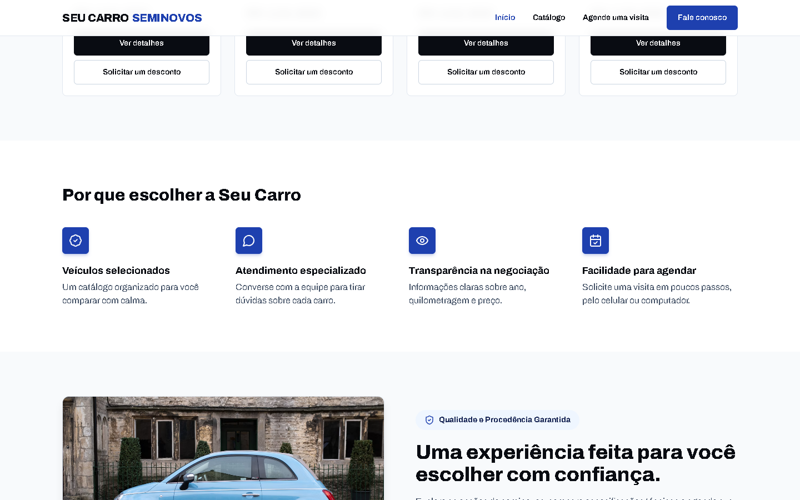
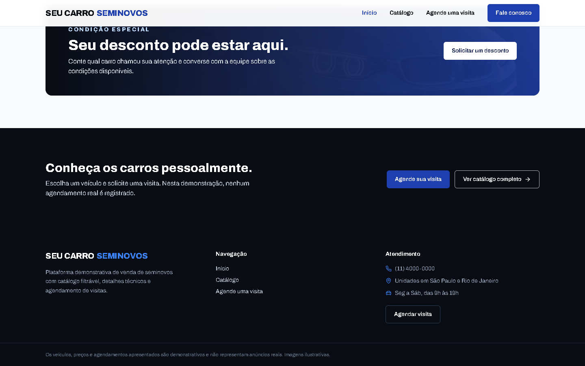
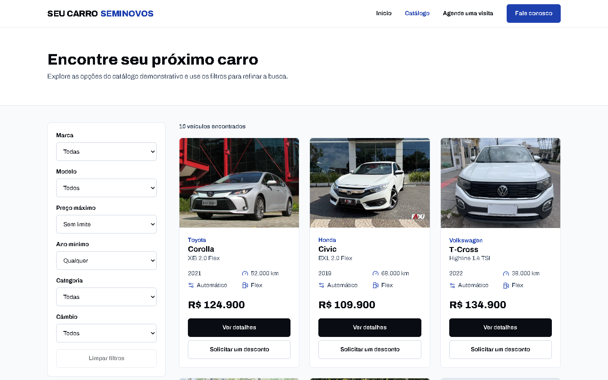
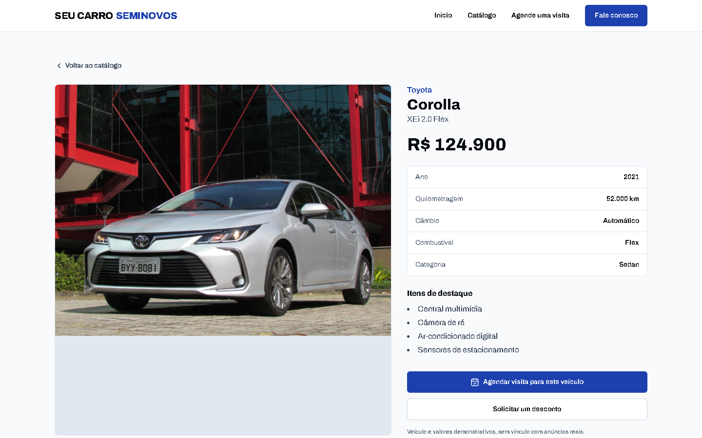
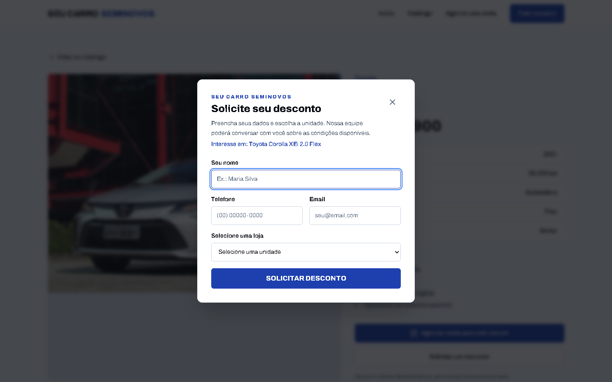
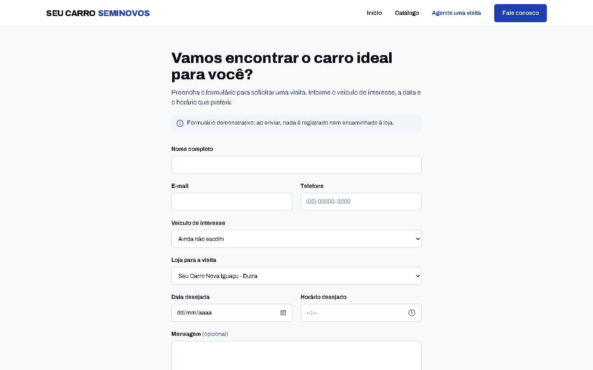

# Seu Carro Seminovos

Aplicação front-end para venda e vitrine de veículos seminovos, desenvolvida com **React**, **TypeScript**, **Vite** e **Tailwind CSS**, utilizando identidade visual em **azul escuro e preto**.

> **Aviso demonstrativo:** Os veículos, preços, unidades e agendamentos exibidos são fictícios e servem apenas para demonstração da interface e dos fluxos de navegação.

---

## Funcionalidades

- **Página Inicial (`/`):**
  - Seção hero com chamada principal, botões de ação e barra de busca rápida integrada.
  - Vitrine de **veículos em destaque** com especificações resumidas (ano, quilometragem, câmbio e combustível).
  - Bloco de diferenciais da plataforma, seção de showroom e banner de condição especial.
- **Catálogo de Veículos (`/catalogo`):**
  - Filtros combinados em tempo real sincronizados com a URL (`marca`, `modelo`, `precoMax`, `anoMin`, `categoria`, `cambio`).
  - Seleção dinâmica de modelos de acordo com a marca escolhida.
  - Estado vazio amigável com botão para limpar filtros e painel retrátil em dispositivos móveis.
- **Detalhes do Veículo (`/veiculo/:id`):**
  - Galeria principal com fallback automático em caso de falha de carregamento.
  - Ficha técnica completa, lista de itens de destaque, botão direto para agendamento pré-selecionado e modal de solicitação de desconto.
- **Agendamento de Visita (`/agendar`):**
  - Formulário completo com validação de nome completo, e-mail, telefone com máscara automática `(00) 00000-0000`, data mínima (hoje), horário, seleção de veículo, loja e aceite de contato.
  - Tela de confirmação demonstrativa com resumo dos dados preenchidos.
- **Modal de Solicitação de Desconto:**
  - Acessível a partir dos cards de veículos, página de detalhes e seções da página inicial, com fechamento via tecla `Esc` ou clique fora do diálogo.

---

## Tecnologias Utilizadas

- **React 18** + **TypeScript**
- **Vite**
- **Tailwind CSS** (tema customizado em azul escuro `#1E40AF` / `#172554` e preto `#090C12`)
- **React Router DOM**
- **Lucide React** (ícones)

---

## Estrutura do Projeto

```text
seu-carro/
├── docs/
│   └── screenshots/          # Capturas de tela da aplicação
├── public/
│   └── favicon.svg           # Ícone da aplicação
├── src/
│   ├── components/           # Header, Footer, SearchBar, VehicleCard, VehicleFilters, Modal de Desconto, Select, VehicleImage
│   ├── data/                 # Catálogo de veículos e lista de unidades
│   ├── hooks/                # Hook useVehicleFilters com sincronização via query params
│   ├── lib/                  # Utilitários de formatação (preço, km, telefone, data)
│   ├── pages/                # Home, Catalog, VehicleDetails, ScheduleVisit e NotFound
│   ├── types/                # Tipagens TypeScript dos veículos e filtros
│   ├── App.tsx               # Definição de rotas e layout base
│   ├── index.css             # Diretivas Tailwind e classes utilitárias (.btn-primary, .btn-dark, .field)
│   └── main.tsx              # Ponto de entrada da aplicação
├── index.html
├── package.json
├── tailwind.config.js
└── tsconfig.json
```

---

## Telas da Aplicação

### 1. Página Inicial — Hero e Busca Rápida


### 2. Página Inicial — Diferenciais e Showroom


### 3. Página Inicial — Condição Especial e Rodapé


### 4. Catálogo com Filtros Combinados


### 5. Detalhes do Veículo


### 6. Modal de Solicitação de Desconto


### 7. Formulário de Agendamento de Visita


---

## Como Executar Localmente

Pré-requisitos: **Node.js 18+** e **npm**.

1. Instale as dependências:

   ```bash
   npm install
   ```

2. Inicie o servidor de desenvolvimento:

   ```bash
   npm run dev
   ```

3. Acesse no navegador o endereço exibido no terminal (geralmente `http://localhost:5173`).

4. Para gerar a versão de produção e verificar a tipagem TypeScript:

   ```bash
   npm run build
   ```

   Os arquivos finais serão gerados na pasta `dist/`.
